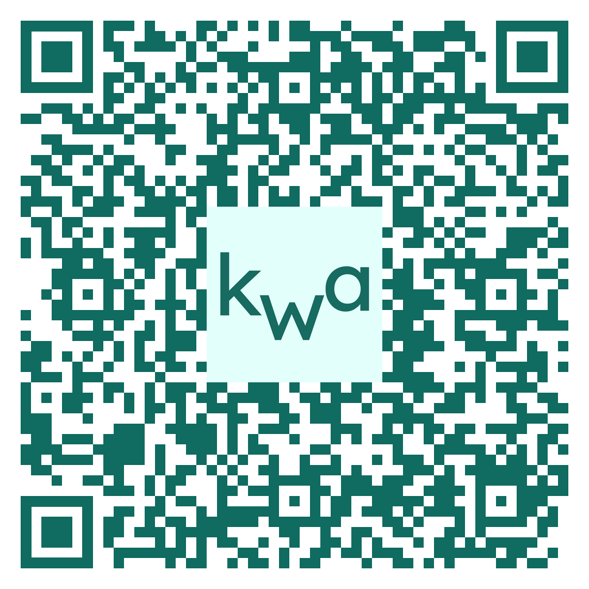
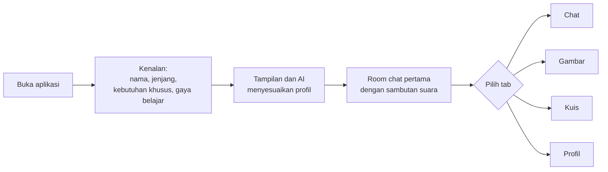
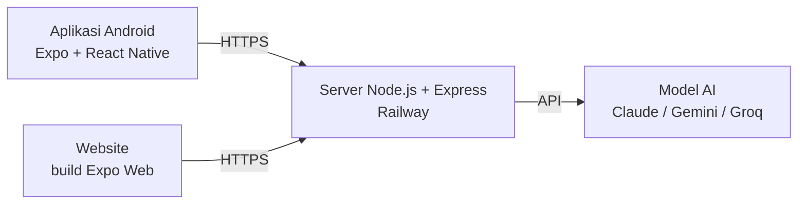

<div align="center">

# Kawa.Ai

**Tutor AI yang bisa menyesuaikan diri dengan tiap siswa.**
Untuk SD sampai SMA/SMK, termasuk siswa dengan disleksia, ADHD, dan autisme.

[](https://kawa-ai-server-swart.vercel.app)
[](https://expo.dev/accounts/kawaai/projects/pintar/builds/381c4898-b5b8-49a6-b8ab-41fc33d7993b)

</div>

---

## Coba sekarang

| Versi | Cara buka |
|---|---|
| Website | [kawa-ai-server-swart.vercel.app](https://kawa-ai-server-swart.vercel.app) |
| Android (APK) | [Halaman unduh APK](https://expo.dev/accounts/kawaai/projects/pintar/builds/381c4898-b5b8-49a6-b8ab-41fc33d7993b) atau scan QR di bawah |

<div align="center">



*Scan pakai kamera HP untuk membuka halaman unduh APK*

</div>

**Soal pemasangan APK:** karena dipasang di luar Play Store, Android bisa memunculkan peringatan Play Protect. Ketuk **Detail lainnya**, lalu **Tetap instal**.

---

## Kenapa Kawa.Ai dibuat?

Sekarang banyak kegiatan belajar sudah memakai AI sebagai teman belajar. Tapi dari banyak AI yang kami coba, sulit sekali menemukan yang benar-benar cocok untuk siswa yang kesulitan belajar. Biasanya kalau mau menyesuaikan karakter AI, kita harus menulis sendiri secara manual lewat teks. Selain itu, hampir tidak ada tampilan atau tema yang dibuat untuk anak yang kesulitan memakainya.

Padahal cara belajar tiap anak berbeda:

- Anak disleksia sulit membaca teks yang padat.
- Anak ADHD gampang hilang fokus kalau jawabannya panjang.
- Anak autisme biasanya lebih nyaman dengan bahasa yang apa adanya dan susunan yang selalu sama.

Karena itu kami membuat Kawa.Ai. Tampilan dan cara AI menjawab ikut menyesuaikan profil siswa. Dengan begitu siswa jadi lebih nyaman memakai AI, dan penjelasan yang sama bisa dipahami lebih banyak anak.

dan Kawa.Ai dibuat untuk **belajar**, bukan untuk memberi jawaban. Untuk PR, Kawa membantu siswa memahami langkahnya dulu, tidak langsung memberi jawaban akhir.

## Untuk siapa?

Kawa.Ai dibuat untuk siswa dan juga bisa untuk siswa penyandang disabilitas atau yang punya kendala bahasa, dan tertinggal karena metode belajar beragam yang membuat mereka sulit mengikuti pelajaran.

Kalau seorang siswa ketinggalan materi di kelas, dia bisa mengejarnya sendiri dengan Kawa:

- **Karakter sesuai kebutuhannya.** Siswa memilih sendiri karakter AI yang cocok, misalnya singkat, sabar dengan banyak contoh, atau santai. Karakter ini bisa diganti kapan saja.
- **Materi sendiri.** Siswa bisa upload materi atau buku pelajaran, lalu bertanya tentang isinya. Jadi yang dipelajari sama dengan yang diajarkan di kelas.
- **Gambar/Menulis.** Siswa yang kesulitan mengetik bisa menulis rumus atau soal dengan tangan di fitur Gambar, lalu bertanya cara menyelesaikannya. Kawa menjelaskan langkahnya satu per satu.
- **Tampilan yang nyaman.** Tema aplikasi bisa disesuaikan (font, warna, jarak teks, animasi), jadi siswa tidak capek mata atau terganggu saat belajar.

---

## Fitur

**Kenalan dulu**
Kawa menanyakan nama, jenjang, kebutuhan khusus (kalau ada), dan gaya belajar yang disukai. Setiap pertanyaan dibacakan dengan suara.

**Chat**
Tanya apa saja soal pelajaran. Bisa kirim foto soal, bicara lewat mikrofon, dan obrolan disimpan per room.

**Gambar**
Tulis tangan, tulis rumus, atau gambar sesuatu di kanvas. Kawa membacanya lalu menjelaskan.

**Kuis**
Soal dibuat AI dari topik pilihan atau dari materi yang kamu upload. Ada kuis biasa dan mode pixel (melawan monster). Di akhir ada kesimpulan skor dan bagian yang perlu diulang. Kuis lama bisa dimainkan lagi dari riwayat.

**Materi sendiri**
Upload PDF kurikulum. Aplikasi hanya mengirim bagian yang berkaitan dengan pertanyaanmu.

Kalau belum punya materinya, buku pelajaran bisa diunduh gratis di [buku.kemendikdasmen.go.id/katalog](https://buku.kemendikdasmen.go.id/katalog). Unduh bukunya sebagai PDF, lalu upload di menu **Profil**. Ukuran file maksimal 15 MB per upload, jadi kalau bukunya lebih besar, kecilkan dulu PDF-nya.

### Penyesuaian otomatis

| Mode | Tampilan | Cara AI menjawab |
|---|---|---|
| Disleksia | Font OpenDyslexic, latar krem, jarak huruf dan baris lebih lebar | Kalimat pendek, paragraf kecil |
| ADHD | Kontras tinggi, tanpa animasi | Maksimal 4 kalimat atau langkah, jawaban langsung di kalimat pertama |
| Autisme | Warna lembut, tanpa animasi | Bahasa literal tanpa kiasan, susunan selalu sama: Tujuan, Langkah, Ringkasan |
| Standar | Mengikuti jenjang | Penjelasan lengkap, boleh pakai analogi |

Kalau ada aturan yang bentrok, urutannya: keamanan, mode tampilan, jenjang, lalu gaya belajar.

### Aksesibilitas

- Suara AI membacakan pertanyaan dan jawaban (bisa dimatikan)
- Tombol besar (minimal 44 px) dengan label teks
- Alat gambar bisa dibaca pembaca layar
- Gaya belajar yang diketik siswa difilter supaya tetap aman

---

## Alur pemakaian



1. Siswa mengisi profil lewat obrolan singkat dengan Kawa.
2. Tampilan dan gaya jawaban AI langsung berubah sesuai pilihan.
3. Siswa belajar lewat Chat, Gambar, atau Kuis. Riwayat tersimpan dan bisa dibuka lagi.
4. Di Profil, siswa bisa ganti mode, ganti gaya belajar, dan upload PDF materi.

## Coba yuk aplikasi kami!

1. Buka [websitenya](https://kawaai-production.up.railway.app/) atau pasang APK.
2. Isi nama, pilih **SMP**, pilih **Ya** untuk kebutuhan khusus, lalu **Disleksia**. Lihat font dan warnanya berubah.
3. Di tab **Chat**, tanya "Jelaskan fotosintesis". Lalu ganti mode ke **ADHD** di Profil dan tanya hal yang sama. Bandingkan jawabannya.
4. Di tab **Gambar**, tulis "2 + 3 = ?" pakai jari lalu kirim.
5. Di tab **Kuis**, buat kuis dari topik apa saja dan coba mode pixel.
6. Di **Profil**, upload PDF materi (yang teksnya bisa diseleksi), lalu tanyakan isinya di Chat. Bukunya bisa diunduh dulu dari [buku.kemendikdasmen.go.id/katalog](https://buku.kemendikdasmen.go.id/katalog).

---

## Cara kerjanya



- API key hanya ada di server, tidak pernah ada di aplikasi.
- Satu server melayani website dan API sekaligus.
- Data siswa (profil, riwayat, galeri) disimpan di perangkat. Tidak ada akun.
- Penyedia AI bisa diganti lewat file `.env`, tanpa ubah kode.

---

## Teknologi

| Bagian | Yang dipakai |
|---|---|
| Aplikasi | React Native, Expo, expo-speech, expo-speech-recognition |
| Website | Expo Web (react-native-web) |
| Server | Node.js 20+, Express, Multer, pdfjs-dist |
| AI | Claude (bisa diganti Gemini atau Groq) |
| Deploy | Railway (server dan website), EAS Build (APK) |

---

## Isi folder

```
Kawa.Ai/
├── mobile/     Aplikasi Expo (Android dan website)
├── server/     Server Express, sekaligus menyajikan website di server/public
├── desktop/    Pembungkus Electron untuk versi .exe
└── docs/       Gambar untuk dokumentasi
```

---

## Menjalankan di komputer sendiri

Yang kamu butuhkan:

- **Node.js 20 atau lebih baru.** Unduh versi LTS di [nodejs.org](https://nodejs.org), lalu pasang seperti biasa.
- **API key untuk AI.** Yang gratis: Gemini, buat di [aistudio.google.com/apikey](https://aistudio.google.com/apikey).
- Koneksi internet saat pertama kali memasang.

### Cara 1: tanpa git (paling mudah)

1. **Unduh kodenya.** Buka halaman repo di GitHub, klik tombol hijau **Code**, lalu **Download ZIP**.
2. **Ekstrak ZIP-nya.** Klik kanan file ZIP, pilih **Extract All** (di Mac cukup klik dua kali). Hasilnya folder bernama seperti `Kawa.Ai-main`.
3. **Buka terminal di folder `server`.**
   - Windows: masuk ke folder `server` di File Explorer, klik kotak alamat di atas, ketik `cmd`, lalu Enter.
   - Mac: klik kanan folder `server`, pilih **New Terminal at Folder**.
4. **Pasang paket.** Ketik perintah ini lalu Enter:

   ```bash
   npm install
   ```

   Pertama kali bisa makan waktu beberapa menit, karena website ikut dibangun. Tunggu sampai selesai.
5. **Buat file `.env`.** Di folder `server` ada file `.env.example`. Salin file itu, lalu ubah namanya jadi `.env`. Buka dengan Notepad, ganti tulisan `isi_api_key_di_sini` dengan API key kamu, lalu simpan.
   - Windows: pastikan namanya benar-benar `.env`, bukan `.env.txt`. Kalau ekstensi file tidak kelihatan, aktifkan dulu lewat menu **View > Show > File name extensions**.
6. **Jalankan servernya.**

   ```bash
   npm start
   ```

7. Buka **http://localhost:3000** di browser. Selesai.

Untuk mematikan server, tekan `Ctrl + C` di terminal. Lain kali, kamu cukup mengulang langkah 3 dan 6 (tidak perlu `npm install` lagi).

Kalau kamu mengubah kode di folder `mobile/`, bangun ulang websitenya dengan `npm run build:web` di folder `server`.

### Cara 2: pakai git

```bash
git clone https://github.com/ZaidAlHibb/Kawa.Ai
cd Kawa.Ai/server
npm install
```

Lalu buat `.env` seperti langkah 5 di atas dan jalankan `npm start`.

### Isi file `.env`

Contoh untuk Gemini:

```env
AI_API_KEY=isi_api_key_kamu
AI_BASE_URL=https://generativelanguage.googleapis.com/v1beta/openai
AI_MODEL=gemini-2.5-flash
AI_REASONING_EFFORT=none
AI_FALLBACK_MODELS=gemini-2.5-flash-lite
PORT=3000
```

| Nama | Fungsi | Wajib |
|---|---|---|
| `AI_API_KEY` | API key dari penyedia AI | Ya |
| `AI_BASE_URL` | Alamat API penyedia AI | Ya |
| `AI_MODEL` | Model utama | Ya |
| `AI_FALLBACK_MODELS` | Model cadangan kalau kena batas | Tidak |
| `AI_REASONING_EFFORT` | Isi `none` supaya jawaban lebih cepat | Tidak |
| `PORT` | Port server | Tidak |

Jangan bagikan atau commit file `.env`, karena isinya API key kamu.

### Kalau ada masalah

| Masalah | Yang bisa dicoba |
|---|---|
| `npm` tidak dikenali | Node.js belum terpasang. Pasang dulu, lalu tutup dan buka lagi terminalnya. |
| Website kosong atau muncul tulisan "Website belum dibangun" | Jalankan `npm run build:web` di folder `server`. |
| Muncul pesan API key salah | Cek isi `.env`: tidak boleh ada spasi atau tanda kutip berlebih, dan pastikan sudah disimpan. |
| Port 3000 sudah dipakai | Ganti `PORT=3001` di `.env`, lalu buka `http://localhost:3001`. |

### Menjalankan aplikasi mobile dari kode (opsional)

Server harus sudah jalan (lihat langkah di atas).

```bash
cd mobile
npm install
```

Buat file `mobile/.env`:

```env
EXPO_PUBLIC_API_URL=http://IP_LAPTOP_KAMU:3000
```

Kalau pakai emulator Android, isi dengan `http://10.0.2.2:3000`. Lalu:

```bash
npx expo start
```

Scan QR-nya dengan Expo Go. Mikrofon tidak tersedia di Expo Go, jadi untuk fitur suara pakai APK.

---

## Deploy

### Server dan website (Railway)

1. Buat project baru di Railway, pilih **Deploy from GitHub repo**.
2. Di Settings, isi **Root Directory** dengan `/server`.
3. Isi environment variable seperti tabel di atas, lalu tambahkan `SKIP_WEB_BUILD=1`.
4. Di Settings, Networking, klik **Generate Domain**.

### APK Android (EAS Build)

1. Isi `EXPO_PUBLIC_API_URL` di `mobile/eas.json` dengan alamat server Railway kamu.
2. Jalankan:

```bash
npm install -g eas-cli
cd mobile
npm install
eas login
eas build -p android --profile preview
```

3. Unduh APK dari link yang diberikan Expo.

---

## Keterbatasan

- Paket gratis penyedia AI punya batas permintaan per menit dan per hari. Server mencoba ulang sekali kalau kena batas.
- PDF hanya bisa dibaca kalau teksnya bisa diseleksi. PDF hasil scan belum didukung.
- Kemampuan membaca tulisan tangan di kanvas tergantung kerapian tulisan dan model AI yang dipakai.
- Mikrofon di website butuh HTTPS dan browser Chrome. Di aplikasi, mikrofon hanya jalan di APK, tidak di Expo Go.
- Unduh gambar dari galeri baru tersedia di versi website.

---

## Kredit

- Font [OpenDyslexic](https://opendyslexic.org/) dan [Lexend Deca](https://fonts.google.com/specimen/Lexend+Deca), lisensi SIL Open Font License
